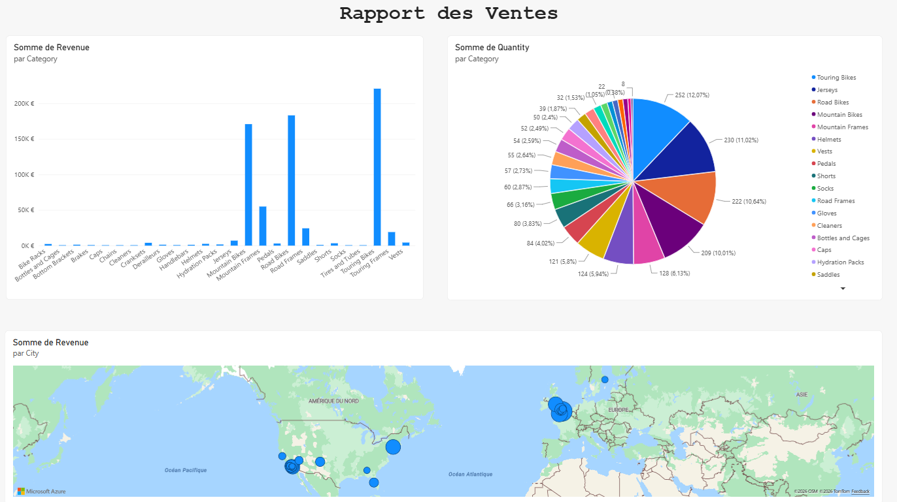

# 📊 Analyse des ventes — Tableau de bord Power BI

Projet de visualisation et d'exploration de données commerciales réalisé avec **Microsoft Power BI Desktop**.

## 🎯 Objectif

Construire un rapport interactif permettant d'explorer le chiffre d'affaires, les quantités vendues et la répartition géographique des ventes.

## 📈 Visualisations du rapport

- **Chiffre d'affaires par catégorie et par produit** : histogramme avec hiérarchie catégorie → produit, permettant de comparer les revenus.
- **Quantités vendues par catégorie** : diagramme circulaire pour visualiser la répartition des volumes.
- **Chiffre d'affaires par ville** : carte Azure Maps pour explorer la dimension géographique des ventes.

## 🗂️ Données exploitées

Le rapport s'appuie sur trois ensembles de données :

- `orders` : commandes, revenus et quantités ;
- `products` : produits et catégories ;
- `customers` : clients et villes.

## 🛠️ Outils et compétences

**Power BI Desktop** · Visualisation de données · Analyse commerciale · Hiérarchies de produits · Cartographie Azure Maps · Exploration interactive

## 📂 Contenu du dépôt

- [`Rapports de ventes.pbix`](./Rapports%20de%20ventes.pbix) : rapport Power BI ouvrable dans Power BI Desktop.
  
## 📊 Aperçu du tableau de bord

  

## ▶️ Ouvrir le rapport

1. Télécharger le fichier `.pbix` depuis ce dépôt.
2. L'ouvrir dans **Power BI Desktop**.
3. Explorer les graphiques et la carte.

> **Remarque :** les visualisations cartographiques peuvent nécessiter une connexion Internet. Ce dépôt présente un projet d'apprentissage ; les résultats chiffrés ne sont pas documentés ici.

## 👩‍💻 À propos

Projet réalisé dans le cadre de ma préparation à l'examen Microsoft Azure Data Fundamentals (DP-900).

📧 [Me contacter](mailto:youmnath.moutairou@groupe-esigelec.org) · 💼 [LinkedIn](https://www.linkedin.com/in/youmnath-moutairou/) · 🐙 [Profil GitHub](https://github.com/Youmnath)
